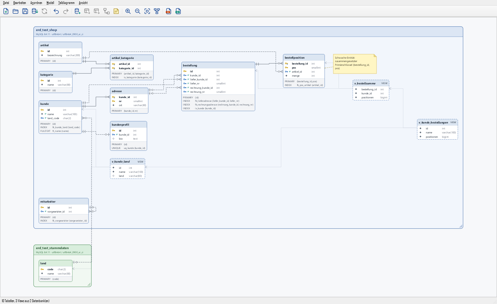

# try-to-make-an-erd-modeler-with-agentic-coding

An ER diagram editor for **MySQL, MariaDB, PostgreSQL and SQL Server** – a desktop replacement for the
EER diagram editor that is no longer part of MySQL Workbench. Built with Python and PySide6, written
entirely through *agentic coding* with Claude Code.



> The user interface is German (*Datei, Bearbeiten, Modell …*). Code identifiers are English,
> comments and the project specification ([PROJEKT.md](PROJEKT.md)) are German.

## Features

**Reverse engineering**
- Reads tables, columns, primary and foreign keys, indexes and comments from MySQL, MariaDB,
  PostgreSQL and SQL Server (Windows authentication or SQL login)
- Views with their columns, SQL text and dependencies on tables and other views
- Several databases in one diagram, each in its own coloured frame; schemas (PostgreSQL,
  SQL Server) as inner frames
- *Reload* keeps your layout: new tables are added, existing positions stay

**Diagram**
- Crow's foot, (min,max) and IDEF1X notation
- Cardinalities derived from the schema (nullable FK → optional, unique FK → 1:1), identifying
  vs. non-identifying relationships, manual overrides per relationship
- Handles self references, composite foreign keys and several foreign keys between the same tables
- Automatic layout, display size 100–200 % (fonts, boxes, symbols – also in print), display options (all/key/no columns, data types,
  indexes, comments)
- Sub-diagrams as tabs with their own layout
- Notes – free or attached to a table
- Fit to window: the whole diagram follows the window size until you zoom yourself

**Modelling (without a database connection)**
- New databases, tables and views; table editor for columns, data types per dialect and indexes
- Relationship tool: drag from child to parent, foreign key columns are created for you
- Rename and delete with all consequences (foreign keys, positions, sub-diagrams, notes)
- Undo/redo for everything

**Export**
- Print with preview, PDF, PNG and SVG
- SQL script (`CREATE TABLE`, foreign keys, `CREATE VIEW` in dependency order) for MySQL,
  PostgreSQL and SQL Server – round-trip tested against real servers

**Safe by design**
- Passwords are never stored in diagram files; they go to the Windows Credential Manager via
  `keyring`

## Getting started

Requirements: Windows, Python 3.11+, for SQL Server an ODBC driver (17 or 18). No Docker needed.

```
python -m venv .venv
.venv\Scripts\pip install -r requirements.txt
.venv\Scripts\pip install -e .
.venv\Scripts\python -m erd_editor.main
```

Without arguments the program opens the *read database* dialog. You can also open a diagram file
(`.erd.json`) directly:

```
.venv\Scripts\python -m erd_editor.main mein-diagramm.erd.json
.venv\Scripts\python -m erd_editor.main --mysql root@localhost shop stammdaten
```

### Useful shortcuts

| Action | Shortcut |
|---|---|
| Read database | Ctrl+D |
| New table / new view | Ctrl+Shift+N / Ctrl+Shift+V |
| Draw relationship | Ctrl+B |
| Add note | Ctrl+Shift+K |
| Automatic layout | Ctrl+L |
| Whole diagram / 100 % | Ctrl+0 / Ctrl+1 |
| Generate SQL script | Ctrl+Shift+Q |

## Tests

```
.venv\Scripts\python -m pytest -q
```

Most tests need no database. The live tests read a shared test schema (`tests/schema/*.sql`,
with all special cases: weak entity, n:m table, self reference, composite and parallel foreign keys,
1:1, views …) from local servers and are skipped when no password is available. Passwords come from
the keyring service `erd-editor-test` (accounts `root`, `root@mariadb`, `postgres`) or from the
environment variables `ERD_MYSQL_PASSWORD`, `ERD_MARIADB_PASSWORD` and `ERD_PG_PASSWORD`
(further: `ERD_MYSQL_HOST/PORT/USER`, `ERD_MARIADB_PORT`, `ERD_PG_HOST/PORT/USER`).
SQL Server is reached with Windows authentication.

## Project layout

```
erd_editor/
  adapters/      read schemas: mysql.py (also MariaDB), postgres.py, mssql.py
  model/         neutral data model (dataclasses, no Qt), editing operations, layout
  analysis/      cardinalities, identifying relationships, view dependencies
  diagram/       QGraphicsScene and items (entities, frames, relationships, notes)
  notation/      line ends: crow's foot, (min,max), IDEF1X
  layout/        automatic layout
  persistence/   diagram files (JSON, schema and layout separated), keyring
  export/        print, PDF, PNG, SVG, SQL
  ui/            dialogs, modelling, sub-diagrams, notes, toolbar
  resources/     SVG icons (drawn for this project), application icon
tools/           icon generator for the toolbar
tests/           pytest suite and the shared test schema
```

The three layers are strictly separated: adapters → neutral model → diagram. The diagram never
knows the SQL dialect. Details: [PROJEKT.md](PROJEKT.md).

## Roadmap

- Compare model and database (differences as `ALTER TABLE`)
- Forward engineering with type mapping between dialects
- Multi-page poster printing for large diagrams
- n:m link tables optionally drawn as one line
- Chen notation view
- Optionally expose the model through an MCP server

## License

[MIT](LICENSE)
